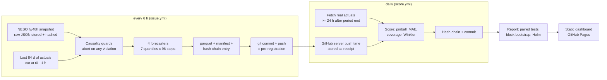

<div align="center">

# ⚡ GB Grid Forecast Scoreboard

**A live, pre-registered, leakage-audited test of whether anyone can beat NESO's own carbon-intensity forecast — and where forecasts fail.**

[](../../actions/workflows/ci.yml)
[](../../actions/workflows/issue.yml)
[](../../actions/workflows/score.yml)


### 👉 [**Live dashboard**](https://ridhimagupta4.github.io/gb-grid-forecast-scoreboard/) · [Pre-registration protocol](PROTOCOL.md) · [Data card & ethics](DATA_CARD.md)

</div>

---

## In one minute

Four times a day, a GitHub Action (i) snapshots **NESO's published 48-hour forecast** of Great Britain's carbon intensity,
(ii) issues **probabilistic forecasts from three transparent models** for the same 96 half-hour periods, and (iii) **commits
both to Git before any of those periods has happened**. A day later, a second Action fetches the real outcomes, scores everything, and
rebuilds a static dashboard.

* **Real data only.** Every number comes from the public Carbon Intensity API. There is no simulation anywhere in the scoreboard.
* **Leakage is defended in depth** (cut-off filters, hard abort guards, a hash-chained ledger, server-side push receipts, frozen hyper-parameters, a causality test that has been mutation-tested). It is *engineered against and audited*, not "impossible" — see [Trust model](#trust-model-what-pre-registration-does-and-does-not-prove).
* **Two fair questions, not one flattering one.** NESO publishes a point forecast with no intervals, so interval models have a built-in advantage on pinball loss. The dashboard therefore reports **probabilistic score and point accuracy separately**, each as its own Holm-corrected pre-registered family.
* **Honest by default.** No verdicts before 28 scored days; every exclusion is counted; pre-registered priors are written down in advance.

> **What is seen at launch:** An intentionally near-empty dashboard that says "warming up". Forecasts are scored ≥ 24 h after their targets, so the first numbers appear after ~2 days, credible comparisons need ≥ 28 days, and a full year is needed to cover every season. This is a long-running study, not a one-off notebook.

---

## The question

1. **Accuracy** — can a transparent model beat NESO's *central* forecast at 0–6 h, 6–24 h or 24–48 h?
2. **Uncertainty** — can it deliver better *probabilistic* forecasts, and are its intervals calibrated?
3. **Failure** — under which conditions known **at issue time** (time of day, day type, NESO forecast level, lead time) do forecasts degrade most?

Carbon intensity (gCO₂/kWh) matters because flexible demand — EV charging, heat pumps, batteries, data-centre jobs — can be shifted
towards low-carbon half-hours. Forecast quality, and honest uncertainty, determine how much carbon that can save.

## How it works



**Timeline for one forecast.** `t0` (issue) → first target starts ≥ 10 min later (push buffer) → target ends → +24 h *scoring lag* → scored against the actual fetched at that moment. Inputs to every forecast end at `t0 − 1 h` (*availability lag*).

## The forecasters

| id | What it is | Why it is here |
|---|---|---|
| `neso_point` | NESO's own forecast, snapshotted at issue time, treated as a degenerate distribution | The benchmark |
| `neso_cqr` | NESO + rolling, finite-sample-corrected empirical residual quantiles from *my own earlier scored snapshots* | Does NESO's error have predictable, calibratable structure? (A calibration of NESO, **not** an independent model) |
| `anomaly_persist` | Local-time climatology + decaying persistence of the latest known anomaly (OLS by lead gap) + empirical residual quantiles | Simple, fully transparent physics-free challenger; strongest at short leads |
| `climatology` | Empirical quantiles by (weekday/weekend × local half-hour) over 12 weeks | The "know nothing" floor |

All specifications are frozen in [`PROTOCOL.md`](PROTOCOL.md) §3 and [`src/gridscore/config.py`](src/gridscore/config.py). There is **no tuning code path**.

## Statistics (and the mishaps deliberately avoided)

| Potential mishap | How it is handled |
|---|---|
| **Data leakage / look-ahead** | Information set fixed by contract; `t0 − 1 h` cut-off; hard guards; benchmark from own snapshot (never the API's retrospective `forecast` field); residual memory only from actuals *fetched* before `t0` |
| **Overfitting / researcher degrees of freedom** | Frozen hyper-parameters; any change ⇒ new protocol version + new model id + new start date; forecasts are out-of-sample by construction |
| **Unfair comparison** | Paired on identical (issue, step) rows; leaderboard on common support only; NESO judged on its own terms (point accuracy) *and* on pinball |
| **Pseudo-replication** (overlapping, autocorrelated forecasts) | Unit of analysis = target day; Newey–West test + 7-day moving-block bootstrap; Wilson intervals on raw rows are *not* used |
| **Multiple testing** | Two pre-registered families × 9 tests, Holm-adjusted; "all horizons" and every stratified cut are descriptive and unadjusted |
| **Conditioning on the outcome** | Strata use only issue-time information; calibration is never stratified by realised value |
| **Over-claiming** | No "better/worse" below 28 scored days; CI must exclude 0 *and* adjusted p < 0.05 |
| **Small-n HAC instability** | Bootstrap CI reported alongside; 28-day floor |
| **Quantile crossing / impossible values** | Sorted per row; clipped at 0 gCO₂/kWh |
| **Survivorship** | Missing NESO/actual rows excluded, counted, displayed; nothing imputed |
| **Peeking** | The page re-evaluates continuously and is **not** corrected for repeated looks; interim verdicts are provisional and the pre-registered formal analysis is at ≥ 365 days |

Metrics: mean pinball over τ ∈ {5, 10, 25, 50, 75, 90, 95} % (for a point forecast = ½·MAE) · MAE of the median · 90 %/50 % coverage with bootstrap CIs · Winkler interval score · mean interval width · reliability curves.
The pinball average over 7 levels is a coarse approximation to CRPS and is **not** presented as CRPS.

## Trust model: what pre-registration does and does not prove

**Mechanisms.**
1. **Hash chain** (`data/ledger.jsonl`) — each entry commits to the SHA-256 of every file written and to the previous entry. `gridscore verify` re-checks it from any clone; the dashboard shows a red *BROKEN* chip if it fails.
2. **Server-side push receipts** — commit dates are client-controlled and weak evidence. Each day the score job reads GitHub's `PushEvent` timestamps (server time), matches them to the commit that added each forecast file, and stores a receipt. A forecast pushed *after* its target period began is marked **`violated`** and excluded everywhere; one without a receipt is **`unverified`** (included, but its share is displayed).
3. **Protect the default branch** (no force-push, no deletion) — see the launch checklist.

**What it does not prove.** The repo owner could, in principle, replace the *entire* history (chain included) before anyone clones it. Defences are social and external: forks/clones of the public repo, a tagged protocol release before the first issue, and — recommended on the [roadmap](#roadmap) — anchoring the ledger head externally (e.g. OpenTimestamps or a Zenodo snapshot). Receipts also rely on the GitHub Events API, which keeps only ~90 days/300 events; the daily job collects them well inside that window.

## The dashboard

A single self-contained static page (HTML + vendored Plotly; no server, no CDN, no trackers), rebuilt after every data-writing run:

1. **Verdict** — forest plot of Δ vs NESO with block-bootstrap CIs; toggle *probabilistic* ⇄ *point accuracy*.
2. **Leaderboard** — common-support table; coverage turns red when the nominal level lies outside the CI.
3. **The forecasts themselves** — fan chart for the latest live batch and for the latest fully scored batch (with actuals).
4. **Calibration** — reliability curves and coverage bars per horizon.
5. **Over time** — daily Δ and 7-day mean.
6. **When does it fail?** — pre-registered strata + the ten biggest NESO misses.
7. **Trust & provenance** — chain status, receipt counts, excluded rows.

## Quickstart

```bash
git clone https://github.com/RidhimaGupta4/gb-grid-forecast-scoreboard && cd gb-grid-forecast-scoreboard
pip install -e ".[dev]"
pytest                 # synthetic fixtures, offline, ~1 min
gridscore smoke        # needs internet: read-only check of the live API's behaviour (writes nothing)
gridscore verify       # re-verify the hash chain of the committed data
gridscore report && gridscore site   # rebuild dashboard from committed data into site_build/
```

## Repository layout

```
├── PROTOCOL.md            frozen pre-registration (definitions, tests, priors, threat model, deviation log)
├── DATA_CARD.md           data, licence, ethics, quality, anti-synthetic safeguards
├── src/gridscore/
│   ├── config.py          every frozen constant
│   ├── api.py data.py     polite API client with provenance; validation (never imputes)
│   ├── models.py          the four forecasters (pure functions of a Context)
│   ├── issue.py           issue a batch + hard causality guards
│   ├── score.py           score matured forecasts, idempotent
│   ├── ledger.py receipts.py   hash chain; server-side push receipts
│   ├── metrics.py stats.py     pinball/coverage/Winkler; HAC test, block bootstrap, Holm
│   ├── report.py site.py + site_template/   aggregation -> summary.json -> static dashboard
│   └── cli.py             gridscore issue|score|receipts|verify|report|site|smoke
├── data/                  append-only: forecasts/ scores/ manifests/ raw/ ledger.jsonl receipts.jsonl
├── tests/                 causality, ledger tamper, stats, e2e (synthetic fixtures; provenance guard)
└── .github/workflows/     ci, issue, score, site, smoke
```

## Limitations

*Scientific*
* **One series, one country, one regime so far.** Early results reflect the current season and wind regime; seasonal claims need ≥ 1 year.
* **Deliberately simple challengers.** No weather, wind, demand or outage covariates, so they are expected to lose to NESO on accuracy. A negative result says "*these transparent models* do not beat NESO", not "nothing can".
* **`neso_cqr` is a calibration of NESO,** not an independent forecaster; its median cannot be much more accurate than NESO's.
* **Probabilistic vs point asymmetry** (see above) — hence the second family.
* **Non-exchangeability.** Conformal-style guarantees assume exchangeable residuals; time series violate that. Coverage is *audited live*, not guaranteed. `anomaly_persist` and `climatology` use in-sample residuals, which makes intervals slightly optimistic.
* **Peeking / sequential looks.** Continuous updating is not corrected for repeated looks; treat interim verdicts as provisional.
* **No formal power analysis.** The 28-day floor is pragmatic; small true differences will be undetectable for months.
* **Dependence.** Overlapping forecasts of the same target are correlated; day-level aggregation and block bootstrap mitigate but do not eliminate this. Small-sample HAC variance is noisy.
* **Calendar effects.** Bank holidays are not modelled; the two DST-transition days have 23/25 hours; "day" in tests is the UTC day while strata use local time.
* **Coarse strata.** NESO-level terciles use cut-points from the evaluation sample (descriptive only). Physical drivers (wind ramps, outages, interconnector flows) are **not** analysed.
* **The common-support leaderboard changes** when a late-starting model becomes eligible; the dashboard states which models are included.

*Data*
* **`actual` is an estimate and can be revised;** this project scores the value seen ≥ 24 h after the period ended and does not track later revisions.
* **Methodology changes at the provider** are invisible structural breaks unless announced.
* **Free API without an SLA:** outages create gaps (never back-filled); breaking changes would require a logged protocol deviation.
* **Licence wording not yet re-verified** in the build environment (see launch checklist).

*Engineering*
* **Scheduling jitter:** GitHub cron may be delayed or skipped. True issue times are recorded; the 10-minute buffer plus per-row receipts protect validity, and late rows are voided rather than trusted.
* **Receipts** depend on the GitHub Events API retention (~90 days/300 events).
* **Not yet exercised against the live API** at the time of writing; use `smoke` first.
* **No lockfile yet** (lower-bound pins only); results are reproducible from the recorded code SHA and data, but exact library versions are not recorded in manifests. *(Roadmap.)*

## Data ethics & responsible use

No personal data, no human subjects, a public free API used politely (≈ 35 requests/day, back-off, descriptive User-Agent, no parallelism), attribution to NESO, explicit non-affiliation, and an explicit **not-for-operational-use** warning. NESO is treated as a good-faith benchmark and evaluated on its own terms. Null and negative results are as welcome as positive ones. Full detail, including the safeguards that keep synthetic data out of the scoreboard, is in [`DATA_CARD.md`](DATA_CARD.md).

## Pre-registered expectations

Written before any data ([PROTOCOL §7](PROTOCOL.md#7-pre-registered-expectations-my-priors-written-before-any-data)): NESO wins on MAE at 6–48 h; the gap is smallest at 0–6 h; `neso_cqr` wins on pinball by construction but ties on MAE; transparent intervals under-cover in regime changes; NESO's largest misses cluster at long leads. If the data disagree, that is the interesting result.

## Roadmap

- [ ] External anchoring of the ledger head (OpenTimestamps / Zenodo) at each month-end
- [ ] Record `pip freeze` in every manifest + lockfile
- [ ] Weather-informed *transparent* challenger (e.g. NWP wind-speed forecast archives as ex-ante covariates) — as a new protocol version
- [ ] Revision audit: re-fetch actuals at +7 d and quantify revision size
- [ ] UK bank-holiday calendar as an ex-ante covariate (new model version)
- [ ] Regional (DNO-region) intensity as a second, pre-registered study
- [ ] Sequential-testing (alpha-spending) view to replace the provisional interim verdicts

## Testing

`pytest` runs 20 tests offline on a **synthetic fixture world that exists only in `tests/` and is never written to `data/`**. Highlights:
* `test_future_actuals_cannot_change_any_forecast` — two worlds identical up to `t0 − 1 h` but wildly different afterwards (and a leak-bait API that returns extra future rows) must produce **bit-identical** forecasts. It has been *mutation-tested*: removing the cut-off filter makes it fail.
* Ledger tamper detection · pinball identities · conformal coverage on i.i.d. data · HAC test size under the null · bootstrap CI coverage · Holm reference values.
* End-to-end 44-day issue → score → report → site run, including causality of the residual memory and honest "insufficient evidence" labelling.
* `test_provenance.py` fails CI if anything under `data/` did not come from the real API.

## Citation, licence, acknowledgements

Code & docs: MIT (see [LICENSE](LICENSE)); cite via [CITATION.cff](CITATION.cff). **Data:** contains data from the Carbon Intensity API, produced by NESO (National Energy System Operator); remains under the provider's own terms. This project is independent and not endorsed by NESO.

Built by **Ridhima Gupta** · [github.com/RidhimaGupta4](https://github.com/RidhimaGupta4)
